# Mis Horas v2: entrega

Resumen de lo que se cambió en la v2, fase por fase. Cada fase es un commit en
la rama de trabajo. Al cierre de cada fase pasan `npm run test` (145 pruebas),
`npx tsc --noEmit` y `npm run build`.

## 1. Lo que se entendió del Excel actual

El archivo de seguimiento tiene tres hojas útiles:

- **"Preautorizacion HE formato"**: el formato oficial **FO-3106**. Encabezado
  con Vicepresidencia, División (LOG), Departamento y "Período del". Columnas
  Fecha · Tipo de Preautorización · Gafete · Asociado · Jornada · Horario
  extraordinario (De / A) · Total horas · Tarea realizada · Firma Jefe ·
  Firma Asociado, más una fila TOTAL. Tiene listas para el tipo (Horas Extras,
  Días Libres Laborados, Feriados Laborados) y para la jornada
  (Diurna / Mixta / Nocturna).
- **"Hoja2"**: el uso real. Una fila por **tramo extra**, con "Tiempo en
  nómina" en decimal (ej. 04:00 → 05:11 = 1.18). Los tramos que cruzan las
  06:00 se parten en dos filas: NOCTURNA 05:00-06:00 y DIURNA 06:00-08:00.
- **"COPIA"**: el historial desde dic-2025, con la misma estructura.

Inconsistencias detectadas en el Excel (la app las evita porque calcula todo
sola):

- Gafete que va subiendo fila por fila (8923795, 8923796…), por haber
  arrastrado la celda.
- Decimales que no cuadran con su tramo: 19:00-19:30 = **1.5** (debe ser
  0.50); 05:00-06:00 = **0.77** (debe ser 1.00); 04:00-04:34 = **1.08** (debe
  ser 0.57); 03:00-03:39 = **1.4** (debe ser 0.65).
- Horas guardadas como texto ("19:00 pm", "05:00am") mezcladas con horas
  reales, y fechas como texto ("1/27/2026").
- La fórmula `=IF(G15>8,G15-8,0)` compara una hora contra el número 8 y
  siempre da un resultado incorrecto.
- Filas duplicadas (27 al 30 de enero y 6, 7 y 9 de abril aparecen dos veces).

### Equivalencias Excel → app

| Excel | App |
|---|---|
| Escribir a mano Fecha, De, A | Botón **Marcar** (o foto con OCR); los días pasados con **Registros > +** |
| Calcular "Tiempo en nómina" a mano | Automático: minutos/60 a 2 decimales **por tramo** |
| Partir las filas en las 06:00 / 19:00 | Automático (motor de cálculo) |
| Elegir Diurna / Nocturna | Automático según el tramo |
| Elegir el Tipo de Preautorización | Automático: día normal, día libre o asueto |
| Gafete, Asociado, Tarea | **Mas > Perfil** (se llenan solos en cada fila) |
| Período del | El corte seleccionado |
| Fila TOTAL | Automática |
| Hoja completa para el jefe | **Mas > Reportes > FO-3106** (.xlsx con el mismo layout) |
| (No existía) | Proyección de pago tipo boleta, alertas, fotos de evidencia y respaldos |

## 2. Bugs corregidos y la prueba que cubre cada uno

| # | Bug | Corrección | Prueba |
|---|---|---|---|
| 1 | En el turno nocturno, después de medianoche la app pedía otra vez "Marcar entrada" y la jornada del lunes nunca se calculaba | Jornada abierta: una entrada sin salida de las últimas 16 h recibe todas las marcas, con la fecha de la ENTRADA | `aplicacion/jornadaAbierta.test.ts`: "caso completo: lunes 21:00 -> receso 00:00-01:00 -> salida 03:00 = una jornada del lunes con 5 h" |
| 2 | El receso era obligatorio y aparecía aunque el día no tuviera receso | Marcar salida siempre está disponible; el receso solo se ofrece si el horario lo tiene | `jornadaAbierta.test.ts`: "sabado de Recibo (sin receso)…", "con receso en el horario…" |
| 3 | Si no se marcaba el receso, no se descontaba | Se descuenta la ventana programada ("receso asumido") | `jornadaAbierta.test.ts` › `resolverReceso` (5 casos) |
| 4 | Las extras se calculaban contra el tope legal (8 h / 7 h): el jueves de Recibo (9 h) y el viernes de Despacho salían como extra, y quedarse después de las 03:00 un lunes no contaba | Extra = fuera de la ventana programada del día; el tope legal queda como alerta | `domain/calculo/motor.test.ts`: casos del Excel (1.18 N; 2.00 D; 1.00 N + 2.00 D; 1.00 N al entrar 19:00; 1.32 N en Recibo), "jueves de Recibo NO genera extra", "lunes de Despacho… SI es extra" |
| 5 | El bruto no incluía el salario fijo | Bruto = salario del corte + líneas | `domain/calculo/montos.test.ts`: "el bruto INCLUYE el salario del corte" |
| 6 | La nocturnidad se cobraba como hora completa a 1.25 | Línea aparte "Nocturnidad 25 %" (recargo de 0.25) | `montos.test.ts`: "nocturnidad es una linea APARTE…: 13.98 h = $9.35" |
| 7 | El asueto se sumaba completo dos veces | Recargo de asueto 1.00 (+0.25 si es nocturno) | `montos.test.ts`: "6 h de asueto nocturno = recargo 1.00 + 0.25…" |
| 8 | Se sumaban minutos y se redondeaba al final (no como en la nómina) | Cada tramo a decimal y luego se suman los decimales | `montos.test.ts`: "dos tramos de 11 min = 0.18 + 0.18 = 0.36" |
| 9 | La foto con OCR se guardaba con la fecha de hoy | Se usa la fecha leída o confirmada; una salida de madrugada va a la jornada del día anterior | `aplicacion/edicionJornada.test.ts` › "foto con OCR…" |
| 10 | La "hora de captura" era la fecha de modificación del archivo | EXIF real con `exifr`; la fecha del archivo solo como respaldo | `utils/exif.ts` (se probó en el navegador) |
| 11 | El horario semilla no era el real y el receso era solo "minutos" | Horario real como fuente de verdad; receso como ventana inicio/fin; migración Dexie v2 | `domain/horario/ventana.test.ts` (39 h y 44 h exactas) y `data/migraciones.test.ts` |
| 12 | Borrar una marca dejaba el cálculo viejo guardado | La jornada incompleta borra su cálculo | Se cubre en `procesarJornada` (se probó en el navegador) |

## 2b. Ajustes con el sistema de marcacion de Walmart

Comparando con una quincena real del sistema de Walmart (20/10 al 04/11):

| Bug / ajuste | Correccion | Prueba |
|---|---|---|
| El asueto se aplicaba a toda la jornada por su fecha de entrada | Por dia calendario (00:00-24:00), como Walmart | `motor.test.ts` › "Walmart: asueto por dia calendario…" (01/11 y 02/11) |
| Agregar un asueto no recalculaba las jornadas | Agregar o borrar un asueto recalcula | (se probo en el navegador) |
| Jornadas calculadas antes de crear los cortes no salian en el corte | Resumen por rango de fechas; generar o editar cortes recalcula | (se probo en el navegador) |
| Asueto nocturno al 225 % | TE2.5_H = 250 % total (recargo 1.5, sin P0.25 aparte) | `montos.test.ts` › "asueto nocturno = TE2.5_H…" |
| LLEG-ANT / SALIR_TARDE de pocos minutos contaban como extra | Tolerancia por defecto 6 min | `motor.test.ts` › 22/10, 27/10 |
| La hora de comida en el asueto no se pagaba | Opcion (activa): se paga como TE5.0 / TE4.0 | `quincenaWalmart.test.ts` |
| Cortes 14 y 28 mal generados | Pago 14 = 20 al 4; pago 28 = 5 al 19 (configurable) | `cortes.test.ts` |
| El FO-3106 ponia toda la jornada como feriado | El tipo va por tramo | `fo3106.test.ts` › "asueto por dia calendario…" |

Totales de la quincena de la app contra Walmart: TE2 0:03, TE2.5 10:00,
TE2.5_H 5:00 y TE4.0 0:17 iguales. TE5.0 da 4:00 contra 3:59 de Walmart,
porque alli la comida empezo a las 00:01.

## 3. Pantallas nuevas

Dirección visual elegida: **"Reloj de turno"**, con paleta inspirada en Walmart.

- Azul #0071DC, amarillo #FFC220 y azul marino. Fondo marino oscuro como tema principal, y tema claro como opción.
- El acento cambia según el turno activo: **azul** en Despacho y **amarillo** en Recibo. El asueto siempre se resalta en amarillo.
- No se usa el logo de Walmart: es una app personal no oficial. El ícono es propio (reloj azul con manecilla amarilla).
- Space Grotesk con números tabulares para horas y montos, y Manrope para el texto, ambas empaquetadas localmente.
- Íconos lucide.
- Se descartó la alternativa "tablero industrial" (claro, monoespaciado, franjas de seguridad) porque se lee peor de madrugada y parece una terminal.

| Pantalla | Captura |
|---|---|
| Marcar (jornada abierta, "llevas 0:25 de extra") | 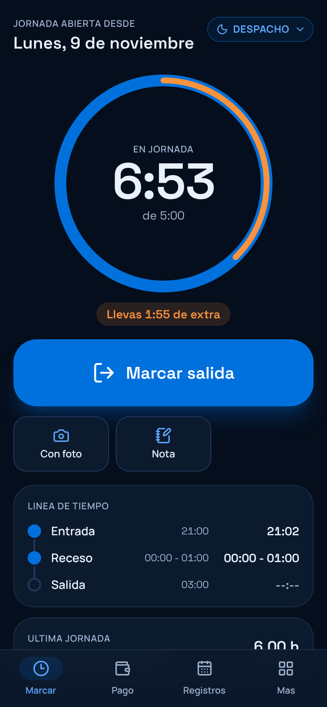 |
| Marcar en tema claro | 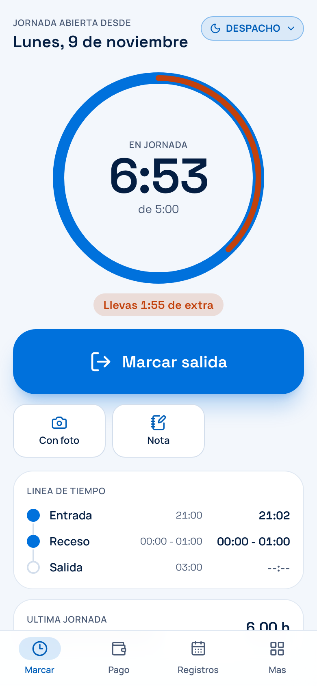 |
| Pago: tu próximo pago y alertas | 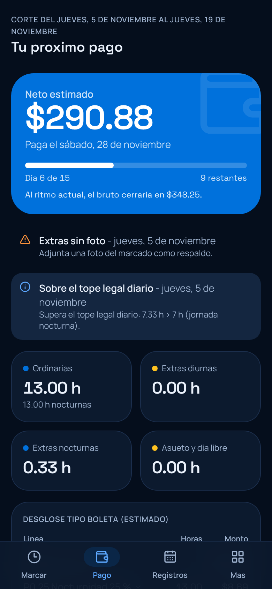 |
| Pago: desglose tipo boleta | 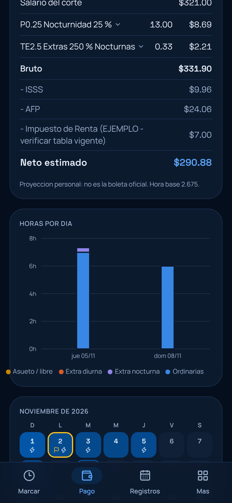 |
| Pago: barras por día y calendario heatmap | 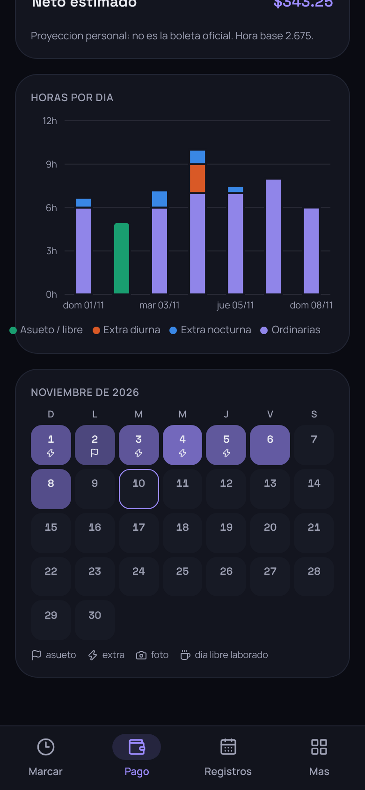 |
| Registros por corte y semana | 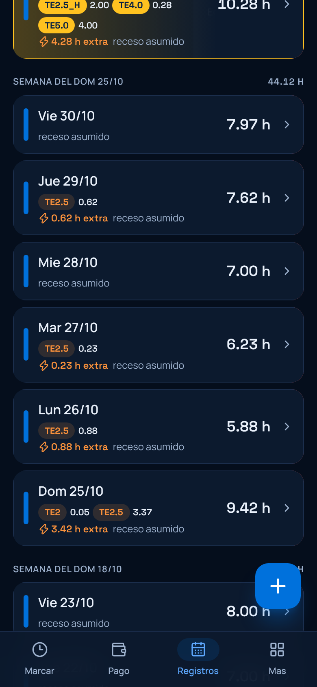 |
| Detalle del 01/11 (asueto 2/11): códigos TE y % por tramo | 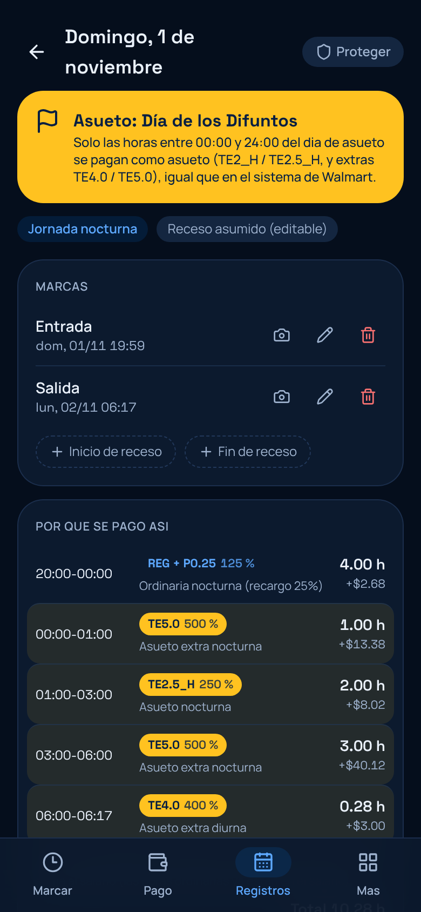 |
| Detalle del 02/11: asueto solo de 21:00 a 24:00 | 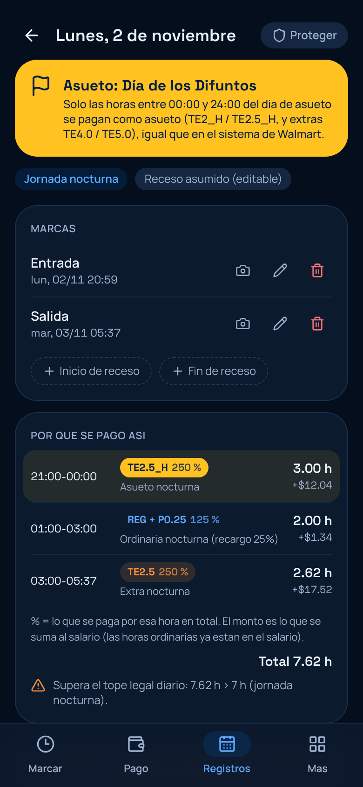 |
| Cortes de pago (14 y 28) | 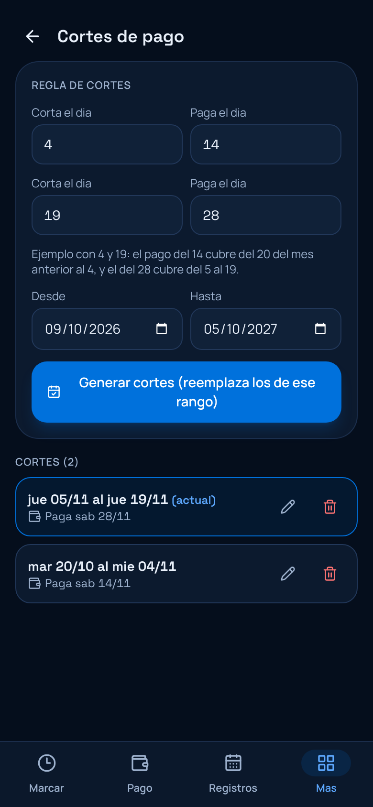 |
| Más: reportes y configuración | 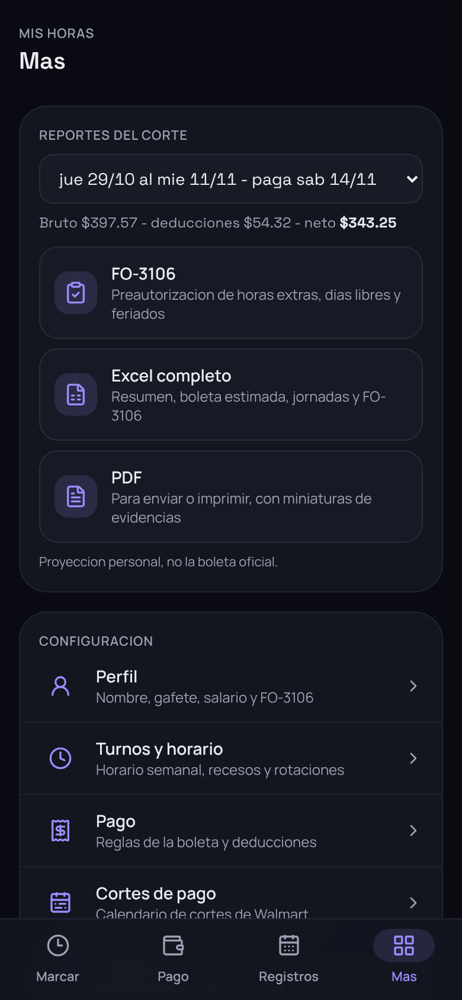 |
| Turnos con editor visual semanal | 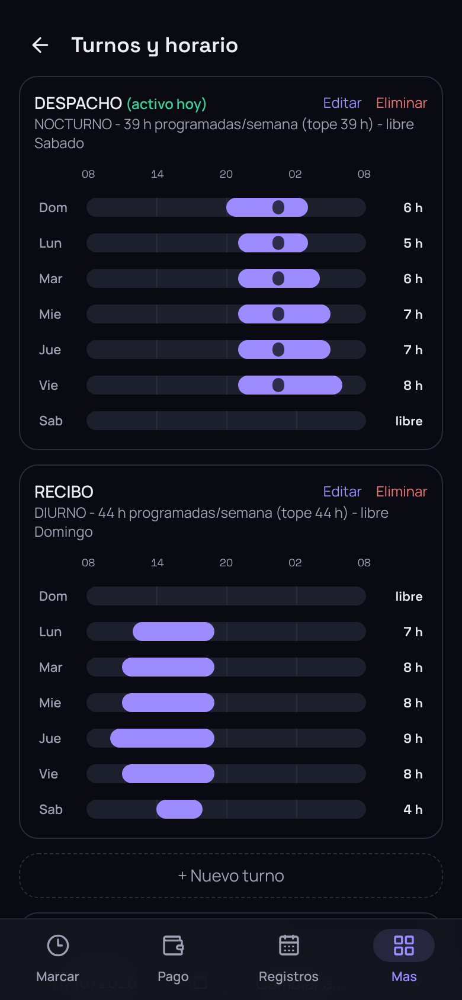 |
| Datos y respaldo (limpieza, ZIP) | 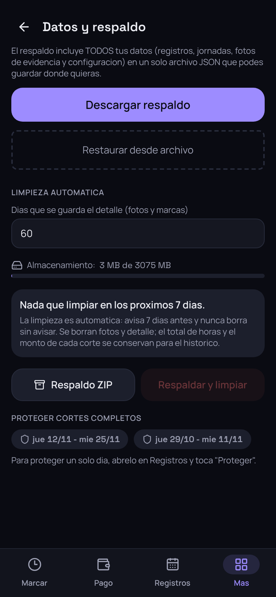 |

## 4. Verificación técnica

- `package-lock.json`: todas las dependencias (738) resuelven a
  `https://registry.npmjs.org`. Las nuevas se instalaron con
  `--registry=https://registry.npmjs.org/`.
- Local: `npm ci` + `npm run test` + `npm run build` + `npx cap sync android`
  funcionan (son los mismos pasos que usan los workflows).
- Los workflows **no se han ejecutado todavía con estos cambios**:
  `deploy-web.yml` solo corre con push a `main`/`master`, y `build-apk.yml`
  con un tag `v*` o manualmente. El build de Gradle (APK) no se probó aquí
  porque este entorno no tiene el Android SDK. Queda por revisar al
  fusionar o al disparar el workflow manual.
- Migraciones de Dexie v2, v3 y v4: los datos existentes se conservan; las
  jornadas se recalculan una sola vez con el motor nuevo al abrir la app.

## 5. Supuestos para validar con RRHH

1. **Asueto nocturno (TE2.5_H)**: se proyecta 250 % total (recargo de 150 % sobre el salario). Confirmar con la boleta cómo aparece esa línea.
2. **Día libre laborado**: por defecto, recargo del 100 % (125 % si es
   nocturno) **más día compensatorio** (Art. 175). Si en tu división se paga
   como hora completa al 200 %, cámbialo en Mas > Pago (modo "pago completo").
3. **Salario del corte**: por defecto, la **mitad del mensual**. Si la boleta
   lo paga proporcional a los días del corte, cámbialo en Mas > Perfil.
4. **Tabla de ISR**: la sembrada es un **ejemplo** de estructura. Verifica la
   tabla de retención vigente (Ministerio de Hacienda) y los porcentajes y
   topes de ISSS y AFP.
5. **Asueto en un día sin horario** (por ejemplo, un asueto que cae en tu día
   libre): hasta el tope legal diario cuenta como asueto y el resto como
   asueto extra.
6. **Hora base** = mensual / 30 / 8. Confirmar que nómina usa esa misma fórmula.
7. **Tolerancia** de entrada y salida: 6 minutos por defecto, según tus marcas (LLEG-ANT /
   SALIR_TARDE de hasta 6 min no se pagaron). Ajustable en Mas > Perfil.
8. **Recibo sin receso descontado** y **Despacho con receso 00:00-01:00
   descontado**, según el horario oficial.
